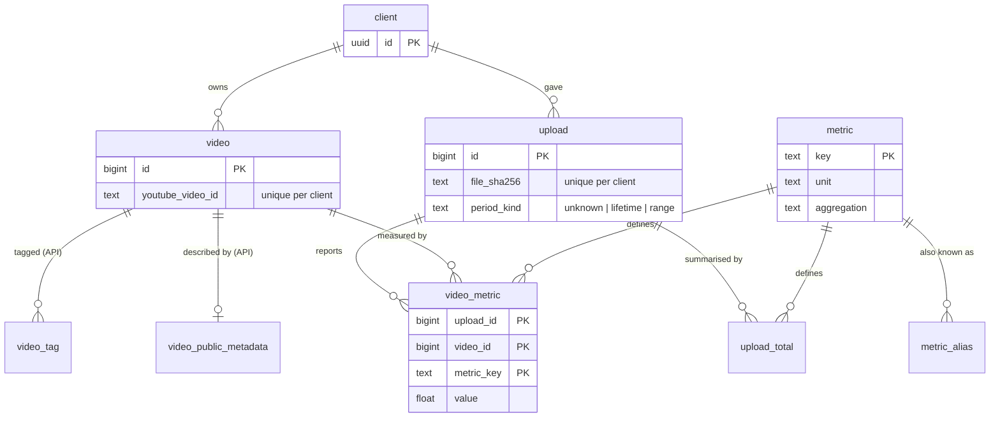

# Data model

How the database is shaped, why, and what was rejected. Written so the design can be explained, not just used.

The schema lives in [`apps/api/db/models.py`](../../apps/api/db/models.py) and is created by the Alembic
migrations in [`apps/api/migrations/`](../../apps/api/migrations/).

## The picture

Every table except `metric` and `metric_alias` also carries `client_id` (omitted above for readability).

## How the design was reached

1. **Entities** are things with their own identity that exist independently: a *client*, an *upload* (one file),
   a *video*. Each became a table.
2. **Events** are measurements. "This video had 9,294 views in this upload" is an event.
3. **Grain** is the sentence "one row means ...". For the measurements it is **one value per video, per
   upload, per metric**. Everything else follows from getting this sentence right.
4. **Attributes of one thing** (a video's title) become columns on that thing. **Repeating things** (a video's
   tags) become their own table with a foreign key back.
5. **Constraints** were written down as rules the database enforces, not rules the code promises to follow.

## Tables

| Table | One row is | Notes |
|---|---|---|
| `client` | a creator | UUID key: it will appear in portal URLs, so it must not be guessable |
| `upload` | one imported file | `file_sha256` makes re-importing the same file detectable; the period it covers starts as `unknown` |
| `video` | one video of one client | only what the creator's export provides |
| `video_metric` | one number for one video in one upload | **long format**; a missing row means "not reported", a `0` row means zero |
| `upload_total` | one number from the export's `Total` row | the `Total` row summarises videos, so it is not a video |
| `metric` | a kind of measurement | the catalog: unit, how it combines, whether it is reviewed |
| `metric_alias` | a spelling of a column header | lets renamed Studio headers map to one metric |
| `video_public_metadata` | API-fetched description, thumbnail, category | expires after 30 days |
| `video_tag` | one tag on one video | API-fetched, so it expires with the metadata |

## Decisions

**D1. Keep API data apart from export data.** YouTube's policy requires API-fetched data to be refreshed or
deleted within 30 days; a creator's export has no such limit. Separate tables mean one cleanup job
(`expires_at` is indexed) can never touch export figures. *Rejected:* nullable API columns on `video`, which
would make the cleanup a column-by-column update.

**D2. Long format plus a metric catalog.** Studio has about 60 metrics and each client exports a different
subset. A column per metric needs a migration for every new one and is half empty; a JSON blob per row has no
types and no integrity on metric names. Long format stores only what was reported, `metric_key` is a foreign
key into the catalog, and wide tables for dashboards are built later as dbt marts. The catalog records each
metric's unit and whether values can be summed, averaged with a weight, recomputed as a ratio, or not combined
(unique viewers cannot be added across videos). *Cost:* the database cannot enforce per-metric rules such as
"views are never negative"; the importer and dbt tests do that.

**D3. Composite foreign keys carry `client_id`.** `video_metric` points at `upload (client_id, id)` and
`video (client_id, id)`, so the database refuses a row that joins one client's upload to another client's
video. Plain foreign keys would accept it, because both ids exist. This is also what makes Postgres
row-level security for the client portal straightforward.

**D4. Deleting a client is one statement.** Every child references its parent with `ON DELETE CASCADE`, so
`DELETE FROM client WHERE id = ...` removes everything in Postgres. A test proves another client's rows
survive. (MongoDB raw data, added later, will need its own deletion step.)

**D5. Unknown columns are kept, not rejected.** The importer registers an unrecognised header as an
`unreviewed` metric and stores its values, so a new Studio metric never blocks an import. They are listed for
review and classification.

**D6. Constraints in the database.** Video IDs must be 11 URL-safe characters; tags must be lower-case and
trimmed; periods must be consistent (a "range" has both dates and start <= end, anything else has none);
values must be finite; ratio metrics need a numerator and denominator. Text plus `CHECK` is used instead of
Postgres `ENUM` types because adding a value to a `CHECK` is an ordinary migration.

**D7. The period is honest about being unknown.** A Studio export does not state its date range, so
`period_kind` starts as `unknown` and records how it was later established (`filename`, `inferred`, `user`).
Comparisons across uploads must not pretend otherwise.

**D8. `double precision` for values.** Counts below 2^53 are exact, percentages are not money, and analysis
code wants floats. *Rejected:* `numeric`, which is exact but arrives in Python as `Decimal` and slows every
calculation for no benefit here.

**D9. Not built yet, on purpose.** Breakdown tables (traffic source, geography, device, date) wait until real
export samples exist. Comments wait for the comment-intelligence phase.

## Terms

- **Primary key**: the column(s) that identify a row. **Foreign key**: a column that must match a row elsewhere.
- **Composite key**: a key made of several columns.
- **Cascade**: deleting a parent row automatically deletes its children.
- **Grain**: what one row means.
- **Normalisation**: storing each fact once (a title is on `video`, not on every metric row).
- **Long format**: one row per measurement instead of one column per measurement.
- **Migration**: a versioned script that changes the database structure, so any environment can be rebuilt.
- **Idempotent**: running it twice has the same effect as running it once (the catalog sync, a file import).

## You should be able to explain

1. What does "grain" mean, and what is it for `video_metric`?
2. Why is the `Total` row not stored as a video?
3. Why does `video_metric` repeat `client_id` when `upload_id` already identifies the client?
4. What does a missing `video_metric` row mean, and how is that different from a row with value `0`?
5. Why long format here, and what does it cost? Where do wide tables come from?
6. Why are API-fetched fields in separate tables?
7. How is "delete my data" guaranteed, and how is it tested?
8. Why UUID for `client` but integers elsewhere?
9. What happens when an export contains a column the system has never seen?
10. How do you know the models and the migrations agree? (`test_migrations_and_models_agree`)
